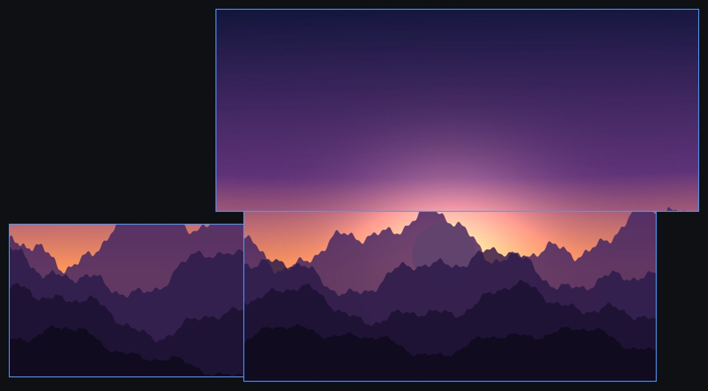

# Spanwall

Span one wallpaper across all your monitors by where they **physically** are,
not how Windows arranges them. Different sizes, densities, gaps, bezels, a
laptop in front, a monitor tilted down, curved ultrawides: Spanwall measures
the real layout (by hand or from one phone photo) and cuts a slice for each
monitor at its native resolution so the picture lines up across the bezels
from where you sit.



Windows 11 (Windows 10 should work). Small (one exe), local (everything runs on
your PC; the editor is a page on `127.0.0.1`), and scriptable (CLI, HTTP API,
and a Claude Desktop extension).

## Features

- **Physical layout** in millimetres, with monitor sizes read from EDID.
  Drag monitors in the browser editor, nudge with arrow keys, snap to edges.
- **Live calibration:** a test pattern in desk millimetres on the real
  screens that updates as you drag, so you can line up lines across bezels.
- **Photo calibration:** show a dot pattern, take one phone photo from your
  seat, done. Spanwall finds every screen, measures position, apparent size
  (a closer laptop looks bigger), tilt and perspective, and the bend of
  curved screens, and warps each slice to match. Later, a photo of a normal
  wallpaper is enough to re-align a monitor that moved.
- **Move and zoom the image** behind the monitors to choose what shows where
  (drag, corner handles, scroll, arrow keys).
- **Slideshow** from a folder (shuffle without repeats, or by name), with
  previous/next hotkeys and a tray icon.
- **Span groups:** span some monitors together and give the others their own
  image.
- **Virtual desktops:** the same wallpaper everywhere, one per desktop, or a
  panorama that slides as you switch desktops.
- **Wallhaven:** search wallhaven.cc (safe for work) with your layout's ratio
  and minimum size preselected, download at full resolution, and auto-download
  new wallpapers from one of your collections.
- **Layouts per setup:** plug monitors in or out and the matching layout is
  applied automatically.
- **Claude Desktop extension:** ask Claude to preview, set, align (send it the
  photo), find or rotate wallpapers.
- **Superpaper compatible:** the span geometry matches Superpaper exactly
  (golden-tested), and its saved arrangement can be imported.

## Install

1. Download the latest `Spanwall-x.y.z-windows-x64.zip` from
   [Releases](../../releases) and unzip it anywhere.
2. Double-click `spanwall.exe`. It installs for your user (no admin rights)
   into `%LOCALAPPDATA%\Programs\Spanwall`, starts at sign-in, and opens the
   editor with a short setup guide.

Windows SmartScreen may warn about an unsigned app; choose More info, Run anyway.

To remove it: `spanwall uninstall` (add `--purge` to delete settings too).

## Quick start

1. **Identify** shows a number on each screen.
2. **Place the monitors.** Easiest: Layout tab, Photo calibration, Show dot
   pattern, take one photo from your normal seat with every screen in frame
   (phone near eye level), and drop it on the panel. Or start from Windows'
   arrangement and drag each monitor to where it really is, using Live
   calibration to check.
3. **Pick a wallpaper** in the Library (your wallpaper folder) or the
   Wallhaven tab, and Apply.

Positions are in mm on the desk: x grows to the right, y grows downward, and
each position is the top-left corner of the monitor's lit area. Moving a
monitor up in the layout moves the image on it down.

## Tray and hotkeys

Left click the tray icon to open the editor; right click for next, previous,
slideshow, identify and quit. Default hotkeys (change them in Settings):

| Hotkey | Action |
|---|---|
| Ctrl+Alt+PgDn | Next wallpaper |
| Ctrl+Alt+PgUp | Previous wallpaper |
| Ctrl+Alt+End | Start or pause the slideshow |

## Claude Desktop

`spanwall install` also builds `Spanwall.mcpb` in the install folder. Open it
and Claude Desktop installs the extension; Claude can then list monitors,
edit layouts, preview and set wallpapers, run photo calibration from a photo
you send in chat, run the slideshow, and search and download from Wallhaven.

## Command line

```
spanwall apply [--mode span|groups|per-display] [--dry-run] <image> [images...]
spanwall next | prev
spanwall slideshow on|off|status [--every minutes]
spanwall wallhaven <id or link> [--apply]
spanwall displays [--json]
spanwall identify [--seconds N]
spanwall layout show | set <mon> <x> <y> | move <mon> <dx> <dy> | import-superpaper
spanwall start | stop          the background app (http://127.0.0.1:47920)
spanwall install | uninstall
```

## Privacy

Everything stays on your PC. The background app listens on 127.0.0.1 only and
rejects requests from other web pages. Settings live in
`%USERPROFILE%\.spanwall`; a Wallhaven API key, if you add one, is stored
there in its own file, sent only to wallhaven.cc as a header, and never shown
again. Photos you calibrate with are read locally and kept in
`.spanwall\inbox` (delete them any time).

## Build from source

Go 1.26 or newer.

```
go test ./...
.\build.ps1        # Windows: vet, test, build bin\spanwall.exe, pack bin\Spanwall.mcpb
```

The span geometry in `internal/geometry` and `internal/render` is checked
against golden output from Superpaper; `python tools/golden/superpaper_ref.py`
regenerates it. `CLAUDE.md` has architecture notes.

## How it works

Spanwall lays every monitor out on a canvas in physical units, scaled so the
densest monitor is 1:1, fits the image to that canvas, and renders each
monitor's part straight from the source image in one Lanczos pass (sharper
than resizing twice). Monitors with a measured shape are rendered through a
perspective or curved-surface warp instead. Each slice is set on its own
monitor through Windows' `IDesktopWallpaper` API, so Windows' own
arrangement never matters.

Photo calibration detects the coloured dots (by the colour of their glow,
since phone cameras clip the centres to white), fits each screen's grid with
a homography plus a smooth correction for curvature, and maps every screen
into one monitor's plane as seen from the camera.

## Credits

The span geometry is ported from [Superpaper](https://github.com/hhannine/superpaper)
(MIT). See NOTICE.

## License

MIT
